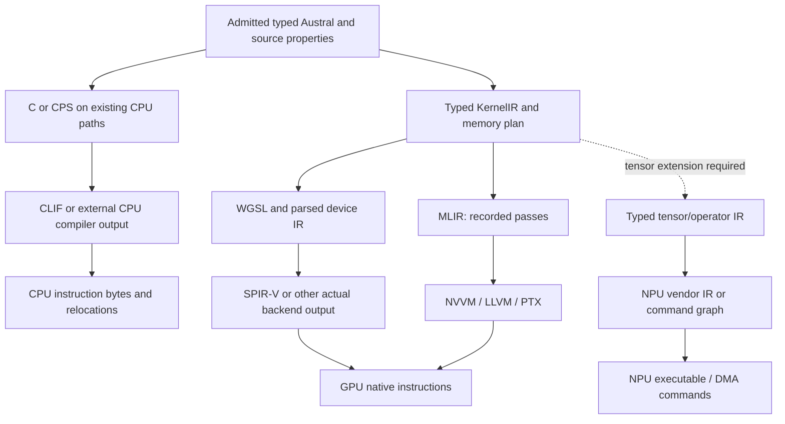

# Compositional MM0 proofs across compiler representations

**Status: proposed, 2026-11-17.** This extends the kernel-authoring plan with the
owner's requirement: properties established at a high representation should be
reused at lower representations, with lower layers discharging remaining
obligations and proving what their transformations introduce.

The executor plan is [PLAN_proof_chain.md](../PLAN_proof_chain.md). It shares
interfaces with [PLAN_gpu_kernels.md](../PLAN_gpu_kernels.md) and the proposed
[GPU v1 contract](gpu/KERNEL_V1.md). This document does not claim that the proof
chain, a CPU/GPU verified compiler, or an NPU backend has been implemented.

## 1. The unit of reuse is a theorem plus its precise premises

For a scalar function, prove an application property once. For a lowering step,
prove that the target program's observable behavior is permitted by the source
program's model. A reusable transfer theorem then carries the property to the
target. Lower layers add obligations about widths, storage, scheduling,
instruction selection or bytes; they do not re-prove the application algorithm.

A semantic safety contract can be written schematically as:

```text
SourceSafe(p, P, A)
Refines(p, q, R, A, B)
--------------------------------------
TargetSafe(q, lift(P, R), A and B)
```

`p` and `q` are particular program objects, `R` relates their states/observations,
`A` contains the source theorem's premises and `B` the new lowering/runtime
premises. `lift` must be a defined predicate translation with a checked transfer
lemma. Merely copying the name `safe` between two representations is insufficient.

A sufficient safety relation includes initial-state correspondence, simulation
of every allowed target step by zero or more source steps, and agreement of
observable outputs/errors. This gives target-trace inclusion in the source
model after the declared observation projection. If the source permits a set of
schedules, every allowed target schedule must map to one of them. A successful
observed execution is not a proof for all schedules.

Safety transfer alone permits stalling. Termination and responsiveness need
separate progress arguments: no unintended stuck states, a bound/ranking for
unobservable stuttering, and named fairness/device-completion assumptions.
A total source function does not make a stalled device complete.

### Example: a clamp kernel

Source Austral computes `min(x,t)` for `Nat32`. Its high-level theorem proves
`result <= t` for all admitted inputs, not just a test vector. KernelIR and the
WGSL helper reuse that theorem. The generated map wrapper adds:

- each load/store index is inside the corresponding buffer;
- distinct active invocations write distinct output elements;
- the output allocation is disjoint from read-only inputs;
- unsigned comparison and 32-bit values retain the source meaning.

A later SPIR-V/PTX/native lowering reuses those results and proves that its
actual instructions, register/address mapping and launch ABI realize them.
It must not silently implement the comparison as signed. Compilation to an
opaque native binary leaves that last correspondence open, even if the clamp
property and WGSL proof are already checked.

Some properties need a relation stronger than output equivalence. Ownership
requires a resource/permission relation. Race freedom requires an event/memory
relation. Timing and termination require progress assumptions. Numerical
approximation requires an error relation. Register reuse can preserve logical
ownership without giving each source variable a distinct physical register.

## 2. Follow the actual representation graph

The goal is a graph with shared theorems and separate backend branches. It is
not a claim that all existing paths already use KernelIR.



Each arrow is a proposed proof obligation or a named unproved/trusted boundary.
A branch that does not exist is `not implemented`; it is not a proof gap in an
imaginary executable. A real executable with an unproved edge has a genuine
proof gap. Capture the branch actually selected, including optimizations,
legalization, linking, relocations and runtime specialization.

| Representation boundary | Reused properties | New obligations or boundary |
|---|---|---|
| Checked Austral → KernelIR | Admitted function properties, scalar semantics, selected ownership evidence | Exact source-body reflection, helper closure, builtin identity, widths and preservation |
| Existing Austral → C/CPS | Source algorithm/resource properties, where their semantics are defined | Actual frontend lowering; current C and CPS routes need their own edges |
| KernelIR → WGSL/Naga IR | Scalar property and memory-plan contract | WGSL value/control semantics, wrapper shape, parsed shader correspondence |
| KernelIR → MLIR and each selected pass | Earlier algorithm/layout claims | Semantics of the dialect subset and pass-local refinement/legality conditions |
| CLIF → CPU bytes | IR value/memory claims | Exact host ISA, instruction semantics, ABI, register allocation, code/relocation correspondence |
| SPIR-V/PTX → GPU bytes | Device-IR computation and memory/schedule properties | Driver/compiler lowering and target execution model; virtual ISA is not native ISA |
| Tensor/operator IR → NPU artifact | Tensor computation and explicit shape/numeric properties | Supported operators, layout, quantization, DMA ordering, native instruction/firmware boundary |
| Runtime launch/completion | Kernel pre/postconditions and resource ownership | Matching buffers, context/generation, synchronization, completion and host-memory visibility |

PTX is a virtual ISA translated to a target GPU ISA, as described in NVIDIA's
[PTX documentation](https://docs.nvidia.com/cuda/parallel-thread-execution/).
SPIR-V validation checks language rules, not equivalence of a compilation, as
described by [SPIRV-Tools](https://github.com/KhronosGroup/SPIRV-Tools).
These are useful intermediate cut points, not proof of final physical execution.

An NPU path needs a named target and supported tensor/operator subset. A scalar
map IR cannot automatically express every NPU programme. [MLIR TOSA](https://mlir.llvm.org/docs/Dialects/TOSA/)
is one candidate operator vocabulary, not a universal NPU ISA. For example,
[OpenVINO's Intel NPU documentation](https://docs.openvino.ai/2026/openvino-workflow/running-inference/inference-devices-and-modes/npu-device.html)
describes conversion to a proprietary format. Such an opaque boundary must remain
explicit unless independently checked semantics/correspondence become available.
The existing fixed-capacity DMA check proves neither tensor arithmetic nor the
contents of such a binary.

## 3. What Hydro demonstrates, and what it leaves trusted

Reference checkout: `../hydro` at
`92e6451bb997872928384323481bc18b22ef850b`. It was read without modification or
building its toolchain. The following are concrete implementation patterns:

| Hydro source | Mechanism | Adaptation to this project |
|---|---|---|
| `hydro_lean/Hydro/Graph/IR.lean` | Typed `Dag`/nodes with a denotation, shared by interpretation/projection layers | One typed KernelIR/memory plan with multiple defined interpretations |
| `Hydro/HydroGenProject.lean` | Generated `M.dag_denote`, relating the elaborated graph to the programme's schedule semantics | Per-compilation source/IR correspondence certificate, with generated proof terms |
| `Project/Model/StepMain.lean`, `WiredMain.lean` | `Dag.step_spec` and `Dag.step_wired` relate different machine readings | Reusable local simulation lemmas plus composition across lowering steps |
| `Project/Process.lean` | One `Dag.iterate` body, with wire/byte variants and a relation to the model | Runtime adapter operations and formal event transitions share explicit interfaces |
| `Project/Model/WireTrace.lean` | `WireTrace.streamOutputsAt_eq` connects byte traces to model outputs | Actual shader/native bytes and launch/completion traces need decoding/semantic links |
| `Hydro/AxCheck.lean`, `internal/FIDELITY.md` | Dependency audits and a precise account of source/runtime correspondence | Exact assumption closure and explicit evidence cut for every claim |

Hydro's fidelity document says the Rust programmes are mirrored into Lean and
that the compiled Rust implementation correspondence remains outside its
formal theorems. Its model also scopes membership/transport assumptions.
Therefore the analogy is **shared IR plus checked transfer inside a stated
model**, not a claim that Hydro already proves arbitrary compiler/machine-code
correctness. This project should make the byte and compiler boundaries explicit
and progressively close them.

Do not wholesale import Hydro's Lean/Mathlib environment. Its local pin differs
from australVM's exporter-compatible Lean shell. Borrow the architecture;
small local definitions/lemmas can use the existing toolchain. Reusing a Lean
proof in an MM0-only claim still requires checking its proof content under the
chosen MM0 theory, not merely exporting its statement.

## 4. Three distinct things currently called evidence

The existing work is useful, but these categories must remain distinct:

| Existing artifact/tool | What it establishes now | Role in the new chain |
|---|---|---|
| `scripts/au2mm0`, `mm0_ring.py`, `docs/kernel_alg.mm0` | Selected ring derivations, with declared bridges/grounded coefficient facts | Reuse matching arithmetic claims only under the correct numeric interpretation |
| `mm0/isa.mm0`, `scripts/isa-encdec` | CPS opcode encoding/decoding laws and a small abstract arithmetic step theory | Reuse those exact lemmas; not a full proof of host-native instructions |
| `mm0/clif.mm0`, `scripts/clif2mm0` | Measured CLIF shape/vocabulary and an unproved refinement obligation | Use measured subjects and pending edges; zero semantic theorems remain zero |
| `mm0/store_projection.mm0` | Stated memory projections; proofs open | A concrete example of an obligation to discharge, not a proven import |
| `mm0/store_projection_toy.*`, Lean/Rust witnesses | A small memory model's stated properties, with explicit axioms/model scope | Patterns for guards, interpretation audits and mutation controls; no automatic Cranelift/Sail connection |
| `scripts/lean2mm0-stmts` | Lean declarations encoded as MM0 statements/axioms | Statement-of-record evidence; never counted as rechecked theorem truth |
| `scripts/lean-typing-proof` | A prototype typing derivation with counted assumed leaves/conversions | Possible incremental proof-content route; assumptions must be discharged and audited |
| `scripts/lean2mm0` | Selected closed computation certificates with a documented structural/grounded split | Reuse only the exact established claim, retaining its trust split |
| Fingerprints and approved statement comparator | Byte identity, drift detection and held-out statement/closure agreement | Bind subjects; approval and hashing do not make a semantic claim true |

The existing RV64 model conversions do not establish AArch64/x86_64 behavior,
and statement conversion does not supply missing semantic proofs. The target
triple, actual instruction decoder and theory version must match the binary.
Do not modify or depend on the unrelated in-progress `lean-typing-proof` work
without inspecting its current status; this plan adds isolated consumers.

## 5. Obligations are typed proof interfaces

For each application theorem and edge, export a proof interface containing:

- source and target semantic objects plus exact representation/byte identities;
- theorem statement, parameter/context bindings and observation/resource relation;
- numeric profile, memory model, permitted effects and schedule assumptions;
- imported checked theorem references and their instantiated statements;
- a deterministic list of remaining obligations, each with an exact formula;
- the transitive foundation/external assumptions and any decoder/capture gap.

An obligation is a named logical premise. Its identity includes canonical
statement/context, semantic theory and source/target binding; a human label is
only a locator. A lower-layer proof discharges that exact premise by a checked
proof term, or by a proved implication from more concrete residual premises.
It may split an obligation, but must prove that the replacements imply it.
A profile rejects obligation deletion, weakening or relabelling without proof.

The premise can be discharged later without regenerating an unrelated algorithm
proof if its public statement and binding remain compatible. Cache reuse needs
checked re-instantiation of parameters, theory and assumption closure. Identical
source text or an identical name is insufficient. A proof cache is content
addressed, but the content includes these semantics, not only the `.aum` digest.

The metadata describes the graph. **Actual MM0 theorem applications implement
logical reuse.** A JSON link, a cited digest, a matching sort name or a theorem
copied in as a new axiom is not a proof of the connection. Imported definitions
must share the intended interpretation and namespace; avoid identifying two
unrelated `St` sorts merely because their names match.

### MM0 truth and conditional results

Foundation axioms and semantic definitions are reviewed, pinned and reported.
There is no claim that MM0 proofs have no foundations. The important boundary
is that a missing compiler-preservation result does not become an unreviewed
axiom granting itself its own conclusion.

Represent unresolved edge obligations as theorem hypotheses. A composition
artifact can then be genuinely MM0-checked **conditionally**, with the exact
open hypotheses listed. It cannot satisfy a profile requiring those obligations
to be proved. Substituting a checked lower theorem can remove a premise; adding
a foundational/external assumption must be visible and governed by policy.

Neither Why3 success nor Lean/Nanoda success is automatically independent MM0
proof checking. A proof-content translation can eventually provide the latter;
until then report separate evidence classes. In particular, a `.mm0` file that
states an encoded Lean theorem as an axiom is not that translation.

## 6. Concrete artifact and checking protocol

Proposed schema: `austral.proof-chain.v1`. Each kernel/binary can carry an
optional `proof-manifest.json` and its SHA-256 reference. Reserve the schema
field before GPU v1 serialization is frozen; later released schemas must version
incompatible changes. The manifest contains separate records:

| Record | Required fields |
|---|---|
| Subject | representation, canonical semantic-object digest, byte digest(s), target/profile, parameters/specialization |
| Claim | exact statement/context identity, property interpretation, subject binding, theorem reference, evidence class |
| Edge | source/target subjects, relation/theory, transformer/tool/pass identity, theorem or pending obligations |
| Obligation | full formula/context identity, allowed scope, owner edge, dependencies, discharge theorem or residual premises |
| Proof | `.mm0`/`.mm1`/checked `.mmb` identities, checker/theory identities, imported proof closure, foundation/external assumptions |
| Cut | deepest established representation for this property/backend, remaining edges, actual/unknown native artifact identity |

Require bounded, duplicate-free parsing and a DAG of proof dependencies. The
checker reconstructs exact theorem applications and runs `mm0-rs compile` plus
`mm0-c` against their actual specifications. It validates that the decoded target
object denotes the bytes named by the subject. Until that decoder link is
proved, record it as a trusted boundary rather than silently equating hash and
meaning. Capture gaps and trusted parsers are first-class assumptions.

The checker reports per claim:

```text
property: clamp-result-bounded
backend: wgsl-vulkan
mm0: conditional
established-cut: parsed-wgsl-v1
open-obligations: naga-lowering, driver-native-lowering, launch-binding
external-assumptions: <explicit transitive list>
```

This is illustrative output, not a current measurement. A property might be
proved at KernelIR, conditional at WGSL, and uncovered at native instructions.
Another property may have a different cut. One scalar “verified depth” or
percentage cannot express that state.

Proposed strict profiles select a claim set, target/cut, allowed foundation and
external assumptions, and maximum open obligations. They compare this policy
against the **transitive theorem dependency closure**, not just manifest labels.
A fully checked IR claim can coexist with an incomplete native chain, but cannot
satisfy a native-required profile. An opaque NPU compiler cannot be hidden under
`native` by assigning its blob a digest.

Classify assumptions as foundations/models, environment conditions, or missing
implementation correspondences. Moving a required lowering theorem into an
allowed external-compiler assumption does not close that edge. A conditional
native-model claim may name that premise; a profile claiming checked compilation
to native instructions must reject the unresolved correspondence. Physical
hardware conformance to its stated ISA/model remains an explicit ultimate trust
boundary even when the software proof chain is complete.

## 7. Numeric and execution refinements

Mathematical integer, modular u32, trapping Int64, real-valued and floating-point
properties have different interpretations. A source ring identity over integers
may transfer to a modular ring through an explicit homomorphism; an order or
no-overflow claim needs more. Preserve the existing no-overflow assumptions
rather than identifying these domains.

For approximate lowering, prove an error relation such as
`distance(lower_result, higher_result) <= epsilon` on an admitted domain.
The application property must have a corresponding robustness theorem: an
upper bound may become `B + epsilon`; a positive-margin claim needs a margin
larger than the propagated error. Error budgets compose through sensitivity
bounds; they are not generally just added. Quantization adds scale/zero-point,
rounding, saturation, accumulator width and layout obligations. Optimizations
that change reduction order need their own exact or approximate relation.

Scheduling/resource proofs track submit, pending, completion, visibility and
reclamation. Same-value outputs do not prove that a buffer was not read after
free. Safety over all modeled interleavings and eventual completion under stated
fairness are distinct claims. A lower layer can discharge a concrete ordering
premise, but cannot silently erase an assumption about external device progress.

## 8. Implementation order and limits

Make interfaces and shared semantic domains part of the initial KernelIR design.
Then prove one nontrivial source property and one real lowering edge, compose
and mutation-test them. Add CPU/GPU/native branches incrementally; map each open
NPU boundary before claiming support. Do not rebuild the same algorithm proof
for every target, and do not attempt full CIC, every LLVM pass and all hardware
models before the first small chain.

[PLAN_proof_chain.md](../PLAN_proof_chain.md) divides this into bounded executor
cards. This proposal leaves existing approved MM0 files, W3 state/count tables,
proof scripts and sibling repositories unchanged. Source review and documentation
checks were performed; no new MM0, Lean, native or accelerator proof was run.
